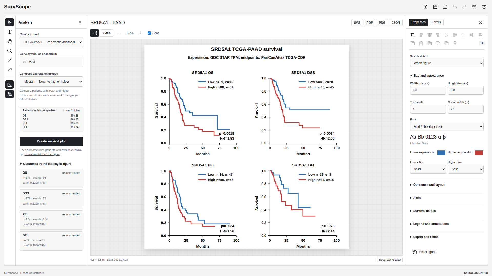
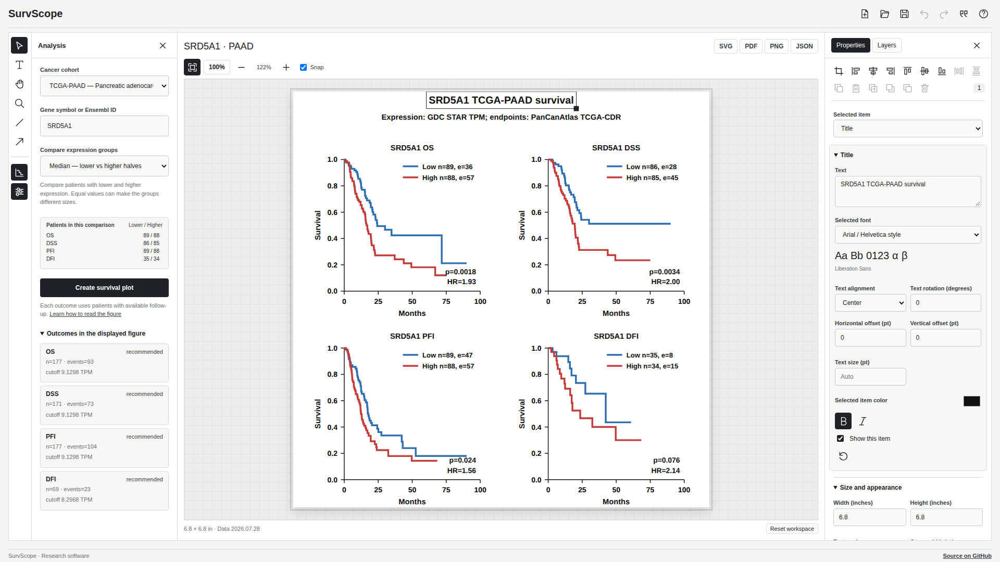
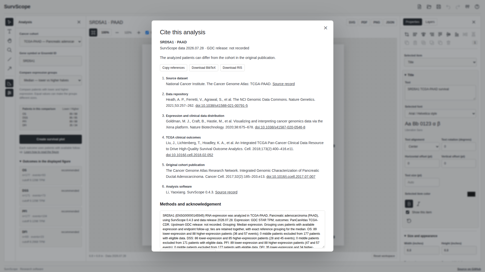

# User guide

## Choose patients and a gene

The **Cancer cohort** menu lists TCGA and CPTAC cohorts. The same cancer in two studies is two separate groups. For example, `TCGA-PAAD` and `CPTAC-3-PAAD` are never combined.

Enter a gene symbol, such as TP53, or an Ensembl ID. The menu shows each cohort's patient count. A plot can use fewer patients when expression or follow-up is missing.

## Choose an expression comparison

Each comparison makes two groups: lower and higher expression.

| Choice | Compares | Left out |
| --- | --- | --- |
| Median | At or below the middle value vs above | No one |
| Mean | At or below the average TPM vs above | No one |
| Percentile | Below vs above a point you pick, such as 75% | No one |
| Lowest/highest quarter | Bottom 25% vs top 25% | The middle |
| Lowest/highest third | Bottom third vs top third | The middle |
| Custom percentile groups | For example, lowest 20% vs highest 30% | The middle |
| Custom TPM threshold | At or below your number vs above | No one |

- TPM measures a gene's RNA level in a sample.
- Equal values stay in the same group. So a "quarter" may not be exactly 25%, and a group can be empty. Check the group sizes before you plot.
- Each outcome uses only patients with follow-up for it. Cutoffs and sizes can differ by outcome.
- Groups that add up to 100% (such as 30%/70%) become one split with no one left out.

Select **Create survival plot** after each change. A notice shows when your choices differ from the plot. SurvScope never hunts for the cutoff with the smallest p-value. Details are in [methods](methods.md#expression-groups).

## Understand the figure

A Kaplan–Meier curve starts at 100%. It steps down at each event. A higher curve means more patients are still event-free.

| Panel | Event |
| --- | --- |
| OS, overall survival | Death from any cause |
| DSS, disease-specific survival | Death from the cancer |
| PFI, progression-free interval | Progression, as defined by TCGA-CDR |
| DFI, disease-free interval | New tumor after being disease-free (TCGA-CDR) |

CPTAC has OS only. Its other panels say **Endpoint unavailable**. Take care with outcomes marked **caution** or **not recommended**. Very small groups may have no result.

| Label | Meaning |
| --- | --- |
| n | Patients in the group |
| e | Patients with an event. The rest are censored (follow-up ended with no event). So e ≤ n. |
| p | Log-rank p-value for the difference between the curves |
| q | Optional adjusted p across this analysis's outcomes. See [q-values](methods.md#adjusted-q-values). |
| HR | Hazard ratio, higher vs lower expression. Above 1 means more events in the higher group. Not adjusted for stage, age, treatment or other factors. |
| NA | Cannot be estimated, for example with an empty group or no events |

**Properties → Survival details** can add confidence bands (90%, 95% or 99%), censor marks (+) and number-at-risk tables. All are off by default.

Results are associations, not proof of cause.

## Edit the figure

- Double-click any text to edit it. Select characters for bold, italic, superscript or subscript. Enter adds a line. Escape finishes.
- Click an object to select it, or pick it from **Selected item**. Drag to move. Use the corner handle to resize.
- Shift-click or drag a box to select several. **Arrange** aligns and spaces them. **Snap** shows guides.
- In **Layers**, the eye hides an object and the padlock locks it.
- Hover over an icon to see its name and shortcut.
- **Analysis** is on the left and **Properties / Layers** on the right. Drag their edges to resize. **Reset workspace** resets the panels, not the figure.

| Key | Action |
| --- | --- |
| V / T / H / Z | Selection / Type / Hand / Zoom |
| Space (hold) | Pan |
| Arrow / Shift+Arrow | Move 1 / 10 points |
| Ctrl/Cmd+Z / Ctrl/Cmd+Shift+Z | Undo / redo |
| Ctrl/Cmd+C / V / D | Copy / paste / duplicate annotations |
| Ctrl/Cmd+B / I | Bold / italic while typing |
| Delete | Remove annotations |

With Type, click an empty spot to add a note. Drag with Line or Arrow to draw one.

| Properties section | What it sets |
| --- | --- |
| **Size and appearance** | Size in inches, font, text size, colors, line width and style |
| **Outcomes and layout** | Which panels show, their grid and order (display only) |
| **Axes** | Time unit, time range, ticks, survival range (display only) |
| **Legend and annotations** | Group names, legend text, notes, lines, arrows |

Legend edits change the figure only. JSON and citations keep the real counts. **Reset selected item** restores the automatic text.

**Fit**, **100%** and zoom change the view, not the export size. **Reset figure** restores the default look and can be undone.

A new gene, cohort or comparison keeps your style. It clears custom labels and notes. Save a project first to keep them.

### Choose a font

Use **Size and appearance → Font** for the whole figure, or **Selected font** for one text object.

| Menu choice | Font used |
| --- | --- |
| Arial / Helvetica style | Liberation Sans (default) |
| Times New Roman style | Liberation Serif |
| Courier New style | Liberation Mono |
| Calibri style | Carlito |
| Lato | Lato |
| Source Sans 3 | Source Sans 3 |
| Source Serif 4 | Source Serif 4 |

The "style" fonts are look-alikes, not the original fonts. Exports embed the fonts, so figures look the same on any computer. See [font sources](fonts.md).

## Download, save, and reopen

| Button | Gives you |
| --- | --- |
| SVG | Vector figure with embedded fonts |
| PDF | Vector figure with embedded fonts, at your page size |
| PNG | Image at 150, 300 or 600 DPI (set in **Export and reuse**) |
| JSON | Results and data sources, without the layout |
| Save project | Results, curves, labels, notes, style and versions |
| Save style preset | Style only |

6.8 inches at 300 DPI gives a 2040 × 2040 PNG. The PNG limit is 40 million pixels.

**Open project** opens a project or preset. Files stay on your computer. A project keeps its results, even from an older data release. Choose **New analysis** to use current data.

A URL saves the gene, cohort and comparison. Share a project file to share the edited figure. Projects contain no patient IDs or expression data.

## Cite an analysis

Choose **Cite this analysis**. Use **Copy references**, **Download BibTeX** or **Download RIS**. The methods text lists gene, cohort, grouping, counts, exclusions and versions. If no cohort paper was checked, or a version was **not recorded**, the panel says so. Save a project to keep citations with the figure. See [all references](citations.md).

## Common questions

### Why is n larger than e?

Some patients have no event during follow-up. n=100, e=30 means 30 events and 70 censored.

### Why are p and q equal in CPTAC?

CPTAC has one outcome (OS). Adjusting one p-value leaves it the same.

### Why are group counts smaller than the cohort count?

Patients with missing expression, missing outcome or zero follow-up are left out. Custom percentile groups also leave out the middle.

### Why is a percentile split uneven?

Patients with equal values stay together.

### Can I see CPTAC protein data?

No. Only RNA is included.

### Will another cutoff give a stronger result?

It may. Trying many cutoffs raises the chance of a false finding. Report what you tried.

### What should I keep?

The project, the JSON and the versions. Report the gene, cohort, outcome, grouping and excluded patients.
